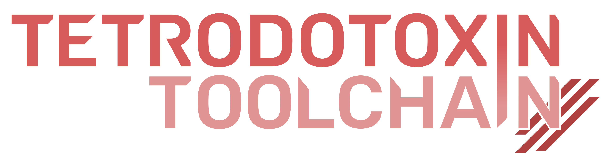

# Tetrodotoxin

  

**A shared semantic graph for languages, runtimes, and tools.** Share capabilities safely across independently evolving systems.

Tetrodotoxin composes systems through the policies and capabilities they choose
to expose. Providers retain their private storage, runtime, implementation
language and object model. Consumers navigate the relationships they understand
and bind typed contracts after agreeing on their data and callable
representations.

[Website](https://tetrodotoxin.dev) ·
[Documentation](https://tetrodotoxin.dev/docs/) ·
[Published releases](https://tetrodotoxin.dev/download/)

## Semantic graph in practice

### Build

Define C and C++ projects once, then reuse the same compiler, validation,
editor and SDK workflow. Toolchain pins the compiler and target SDKs, generates
the editor environment, runs shared validation and packages dependency-complete
SDKs for independently released native libraries.

[Use Toolchain](https://tetrodotoxin.dev/build/) ·
[Set up a project](https://tetrodotoxin.dev/docs/getting-started/development/)

### Infrastructure

Compose independently built systems through negotiated policies and
capabilities.

The Godot integration composes GDScript, C++ and CUDA image providers through
the same TTX contracts. Each provider keeps its algorithms and storage while
Godot discovers the operations it can use. Native builds add CUDA; the browser
build runs the C++ provider through WebAssembly alongside GDScript.

[Open the image lab](https://tetrodotoxin.dev/#godot-lab) ·
[Browse the Godot integration](https://github.com/tetrodotoxin-dev/Godot) ·
[Read the design](https://tetrodotoxin.dev/docs/design/chapter-10/)

### DSLs

Publish a language's Type relationships and capabilities once, then reuse them
across editors, compilers, runtimes and other languages.

Tetrodotoxin provides an extensible Dialect system for building domain-specific
languages on shared infrastructure. MLIR dialects preserve domain semantics
through a compiler pipeline; Tetrodotoxin carries the same leverage across
editor, build and runtime boundaries without requiring independently built
Dialects to share one implementation model.

Source is the foundation supplied with Tetrodotoxin. It turns authored bytes
into a retained lexical stream with stable token identities, source locations,
diagnostics and canonical formatting. Use it beneath a generated parser such as
[ANTLR](https://www.antlr.org/), or consume its cursor directly. Either path can
publish a graph-hosted AST that other Dialects and tools navigate without
learning the parser's private object model.

Puffer is Tetrodotoxin's native front end. It passes each request into Build,
which composes independently packaged Dialects and compiler Terminals into one
workspace. JSON-RPC support belongs to a packaged Dialect around the same front
end. Tetrodotoxin has used that shared model for native builds and a VS Code
extension with hover, completion, cross-package navigation, diagnostics,
formatting, semantic highlighting and native debugging.

[Browse Tetrodotoxin](https://github.com/tetrodotoxin-dev/Tetrodotoxin) ·
[Explore DSLs](https://tetrodotoxin.dev/dsl/)

## The shared boundary

TTX separates the common boundary into three layers:

- **Data** describes canonical data and callable forms, then provides protocols
  for accessing and transferring represented values.
- **Semantic** identifies contracts by UUID and negotiates the representation
  required to use each interface.
- **Graph** connects Abstract observations through routes, policies and
  capabilities supplied by independently implemented providers.

A provider establishes the interface it supplies before the consumer calls its
operations. Each further route or binding remains a separate request, so
systems can share useful capabilities without sharing their private runtime
models.

## Projects

| Project | Responsibility | Available |
| --- | --- | --- |
| [TTX](https://github.com/tetrodotoxin-dev/TTX) | Canonical data, contract negotiation and the shared semantic graph. | [0.4.0](https://github.com/tetrodotoxin-dev/TTX/releases/tag/v0.4.0) |
| [Perimortem](https://github.com/tetrodotoxin-dev/Perimortem) | Runtime primitives, memory, diagnostics, serialization and platform capabilities. | [0.4.0](https://github.com/tetrodotoxin-dev/Perimortem/releases/tag/v0.4.0) |
| [Toolchain](https://github.com/tetrodotoxin-dev/Toolchain) | Pinned compilers, Bazel rules, validation and SDK packaging. | [0.4.1](https://github.com/tetrodotoxin-dev/Toolchain/releases/tag/v0.4.1) |
| [Tetrodotoxin](https://github.com/tetrodotoxin-dev/Tetrodotoxin) | Extensible Dialects, Source, Puffer and language tooling built on TTX. | [Source](https://github.com/tetrodotoxin-dev/Tetrodotoxin) |
| [Photophore](https://github.com/tetrodotoxin-dev/Photophore) | Vulkan rendering, native windowing, input and image resources. | [0.1.0](https://github.com/tetrodotoxin-dev/Photophore/releases/tag/v0.1.0) |
| [CUDA](https://github.com/tetrodotoxin-dev/CUDA) | CUDA compilation, execution and device storage supplied through TTX contracts. | [0.2.0](https://github.com/tetrodotoxin-dev/CUDA/releases/tag/v0.2.0) |
| [Godot](https://github.com/tetrodotoxin-dev/Godot) | The Godot bridge and applications that exercise independently supplied capabilities. | [Source](https://github.com/tetrodotoxin-dev/Godot) |

## Build and contribute

Each repository owns its releases, dependencies and validation. The
[development guide](https://tetrodotoxin.dev/docs/development/) explains those
boundaries and the shared evidence standard. Concrete integration problems,
bug reports and contributions are welcome through the responsible repository.

Tetrodotoxin projects are available under the
[MIT License](https://github.com/tetrodotoxin-dev/Tetrodotoxin/blob/main/LICENSE).
